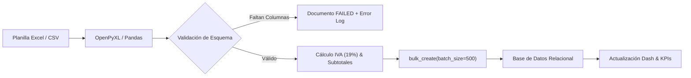

# Enterprise Core: Plataforma de Analítica, Automatización y Pipeline ETL

Plataforma empresarial de nivel corporativo desarrollada **100% en Python puro**, diseñada para centralizar la auditoría comercial, ingesta de planillas Excel/CSV, persistencia relacional transaccional, automatización de tareas en segundo plano y tableros analíticos reactivos en tiempo real.

---

## Índice

1. [Visión General y Propósito del Sistema](#1-visión-general-y-propósito-del-sistema)
2. [Stack Tecnológico y Arquitectura](#2-stack-tecnológico-y-arquitectura)
3. [Estructura del Proyecto](#3-estructura-del-proyecto)
4. [Mapeo de Rutas y Módulos Funcionales](#4-mapeo-de-rutas-y-módulos-funcionales)
5. [Pipeline ETL y Contrato de Datos](#5-pipeline-etl-y-contrato-de-datos)
6. [Motor de Automatización en Background (APScheduler)](#6-motor-de-automatización-en-background-apscheduler)
7. [Tableros Analíticos Reactivos (Plotly & Dash)](#7-tableros-analíticos-reactivos-plotly--dash)
8. [Sistema Visual y Estándares de Diseño](#8-sistema-visual-y-estándares-de-diseño)
9. [Instalación y Puesta en Marcha](#9-instalación-y-puesta-en-marcha)
10. [Credenciales de Acceso](#10-credenciales-de-acceso)
11. [Suite de Pruebas Automatizadas](#11-suite-de-pruebas-automatizadas)
12. [Resolución de Problemas Técnicos (Troubleshooting)](#12-resolución-de-problemas-técnicos-troubleshooting)

---

## 1. Visión General y Propósito del Sistema

En entornos empresariales, los departamentos comerciales, financieros y contables reciben cotidianamente decenas de planillas de cálculo (Excel/CSV) con estructuras heterogéneas, errores de formato, filas duplicadas o márgenes inconsistentes.

**Enterprise Core** resuelve este desafío mediante un ecosistema unificado que:
- **Automatiza la Ingesta:** Carga libros Excel o CSV y valida automáticamente cabeceras y tipos de datos.
- **Normaliza y Audita:** Sanea los registros en memoria mediante operaciones vectorizadas con Pandas, calcula subtotales, IVA (19%) y valida la integridad de cada factura.
- **Garantiza la Persistencia:** Inserta transaccionalmente en la base relacional mediante lotes atómicos (`bulk_create(batch_size=500)`).
- **Ejecuta Tareas Autónomas 24/7:** Monitorea y audita desviaciones periódicas en segundo plano sin intervención humana.
- **Visualiza Inteligencia de Negocios:** Presenta KPIs en vivo, distribuciones geográficas y gráficos interactivos con Plotly Dash sin requerir librerías externas de JavaScript ni Node.js.

---

## 2. Stack Tecnológico y Arquitectura

| Componente | Versión / Librería | Función Principal |
|---|---|---|
| **Lenguaje Base** | Python 3.12.10 | Núcleo completo del sistema (backend, ETL, tareas y visualización). |
| **Framework Web Central** | Django 5.1.15 | Enrutamiento, ORM relacional, control de sesiones, protección CSRF y panel admin. |
| **Visualizaciones Reactivas** | Dash 2.14 & Plotly 7.1 | Tableros dinámicos embebidos mediante `django-plotly-dash` con interactividad pura en Python. |
| **Motor ETL & Sanitización** | Pandas 3.1.1 | Normalización tabular, imputación de valores faltantes y transformaciones vectorizadas. |
| **Manipulación de Hojas de Cálculo** | OpenPyXL 3.1.5 | Ingesta de `.xlsx` y generación de reportes consolidados con fórmulas nativas (`SUM`). |
| **Orquestador en Background** | APScheduler 3.11.3 | Demonio en segundo plano para tareas periódicas (triggers de intervalo y cron). |
| **Base de Datos & Conectores** | SQLAlchemy 2.1.9 / SQLite | Persistencia relacional ACID y transacciones optimizadas por lotes. |
| **Framework de Pruebas** | Pytest 9.2 & pytest-django 4.14 | Suite de 12 pruebas automatizadas unitarias y de integración continua. |
| **Auditoría Estética & Calidad** | Impeccable 4.8.2 | Verificación automática de contraste WCAG AA, padding e iluminación visual. |

---

## 3. Estructura del Proyecto

```text
PYTHON IA/
│
├── config/                          # Configuración central del proyecto Django
│   ├── settings.py                  # Parámetros globales, middlewares, apps y logging
│   ├── urls.py                      # Enrutamiento maestro
│   ├── wsgi.py                      # Interfaz para despliegues síncronos WSGI
│   └── asgi.py                      # Interfaz para canales asíncronos ASGI
│
├── apps/                            # Arquitectura modular desacoplada
│   ├── authentication/              # Módulo de autenticación y sesiones
│   │   ├── urls.py                  # Rutas /auth/login/ y /auth/logout/
│   │   └── views.py                 # Vistas de autenticación
│   │
│   ├── core/                        # Núcleo de bienvenida y Dashboard principal
│   │   ├── urls.py                  # Rutas raíz (/) y dashboard (/dashboard/)
│   │   └── views.py                 # LandingPageView y DashboardView
│   │
│   ├── documents/                   # Módulo de Ingesta, Gestión Documental y ETL
│   │   ├── models.py                # UploadedDocument y CommercialRecord
│   │   ├── forms.py                 # Validación de extensiones (.xlsx, .csv) y peso
│   │   ├── services.py              # Orquestador del pipeline ETL y persistencia
│   │   ├── urls.py                  # Rutas /documents/ y descarga de plantillas
│   │   └── views.py                 # Vistas de carga, listado y regeneración
│   │
│   ├── automations/                 # Módulo de automatización con APScheduler
│   │   ├── models.py                # AutomationJob y ExecutionLog
│   │   ├── scheduler.py             # Arranque seguro del planificador en segundo plano
│   │   ├── tasks.py                 # Funciones ejecutables (auditoría y reportes diarios)
│   │   ├── urls.py                  # Rutas /automations/ y disparo manual
│   │   └── views.py                 # Consola de control y bitácora
│   │
│   └── dashboards/                  # Integración reactiva Django + Plotly Dash
│       ├── apps.py                  # Configuración e inicialización de DashboardsConfig
│       ├── dash_apps/               # Contenedor de aplicaciones reactivas
│       │   └── kpi_overview.py      # App Dash con filtros cruzados y figuras interactivas
│       ├── urls.py                  # Ruta /dashboards/analytics/
│       └── views.py                 # Vista contenedora en Django
│
├── services/                        # Servicios transversales independientes
│   ├── data_cleaner.py              # Validación de esquemas y saneamiento con Pandas
│   ├── excel_processor.py           # Generación de reportes estilizados con OpenPyXL
│   └── db_engine.py                 # Singleton de conexión SQLAlchemy
│
├── templates/                       # Plantillas HTML5 con arquitectura de componentes
│   ├── base.html                    # Layout base corporativo con sidebar Dark Navy y canvas claro
│   ├── core/
│   │   ├── landing.html             # Portal principal con accesos y contrato de datos
│   │   └── dashboard.html           # Dashboard operacional con métricas y tablas recientes
│   ├── authentication/
│   │   └── login.html               # Formulario de inicio de sesión centrado y estilizado
│   ├── documents/
│   │   └── document_list.html       # Dropzone de ingesta, plantilla de prueba y repositorio
│   ├── automations/
│   │   └── control_panel.html       # Panel de tareas activas, disparo manual y bitácora
│   └── dashboards/
│       └── analytics.html           # Vista contenedora del dashboard reactivo Dash
│
├── media/                           # Repositorio de archivos subidos y reportes generados
│   ├── uploads/                     # Archivos originales cargados por los usuarios
│   ├── reports/                     # Reportes consolidados generados por el scheduler
│   └── plantilla_prueba_auditoria.xlsx # Plantilla Excel de muestra lista para pruebas
│
├── logs/                            # Registro estructurado de eventos con rotación
│   ├── app.log                      # Log general del sistema
│   ├── errors.log                   # Excepciones no controladas
│   └── automations.log              # Trazabilidad de tareas en segundo plano
│
├── tests/                           # Suite de pruebas automatizadas con Pytest
│   ├── unit/                        # Pruebas unitarias (limpieza, tipos, OpenPyXL)
│   │   ├── test_cleaner.py
│   │   ├── test_environment.py
│   │   └── test_excel.py
│   └── integration/                 # Pruebas de ciclo de vida ETL, scheduler y vistas HTTP
│       ├── test_etl_and_automations.py
│       └── test_views.py
│
├── pytest.ini                       # Configuración de pruebas para Django y Dash
├── requirements.txt                 # Dependencias congeladas con versiones exactas
└── manage.py                        # Punto de entrada de gestión de Django
```

---

## 4. Mapeo de Rutas y Módulos Funcionales

| URL | Vista / Handler | Descripción |
|---|---|---|
| **`/`** | `core:landing` | **Portal Principal:** Presentación de la suite, acceso directo al login, credenciales de demostración y contrato formal del esquema contable. |
| **`/dashboard/`** | `core:dashboard` | **Dashboard Operativo:** 4 métricas clave en tiempo real, operaciones directas, documentos recientes y bitácora de automatizaciones. |
| **`/auth/login/`** | `authentication:login` | **Autenticación:** Formulario seguro para ingresar al sistema con redirección automática al dashboard. |
| **`/auth/logout/`** | `authentication:logout` | **Cierre de Sesión:** Cierra la sesión activa y retorna a la pantalla de login. |
| **`/documents/`** | `documents:list` | **Gestión Documental & ETL:** Dropzone de carga de archivos Excel/CSV, descarga de plantilla oficial y repositorio con acciones de descarga y reprocesamiento. |
| **`/dashboards/analytics/`** | `dashboards:analytics` | **Analítica Plotly Dash:** Tablero reactivo embebido con filtros por región, categoría y estado de facturación. |
| **`/automations/`** | `automations:control_panel` | **Centro de Automatización:** Tareas activas de APScheduler, disparo manual bajo demanda y bitácora completa de ejecución. |
| **`/admin/`** | `admin:index` | **Panel Administrativo Django:** Gestión granular de modelos, permisos y usuarios del sistema. |

---

## 5. Pipeline ETL y Contrato de Datos

### 5.1. Esquema Contable Obligatorio (8 Columnas)

El motor de validación (`services/data_cleaner.py`) inspecciona cada archivo recibido contra las siguientes reglas estrictas:

| Columna | Tipo de Dato | Regla de Validación y Saneamiento |
|---|---|---|
| `codigo_factura` | `VARCHAR(50)` | Identificador alfanumérico. Se eliminan espacios vacíos en los extremos (`strip`). |
| `cliente` | `VARCHAR(150)` | Razón social o nombre comercial. Validación de no nulidad. |
| `region` | `VARCHAR(100)` | Clasificación geográfica (ej. Norte, Centro, Sur). |
| `categoria_producto` | `VARCHAR(100)` | Categoría comercial del ítem transaccionado. |
| `cantidad` | `INTEGER` | Coerción estricta a entero mayor a cero (`errors='coerce'`). |
| `precio_unitario` | `DECIMAL(12,2)` | Coerción numérica flotante/decimal mayor a cero. |
| `fecha_transaccion` | `DATE` | Conversión segura de formatos de fecha estándar (`YYYY-MM-DD`). |
| `estado` | `VARCHAR(20)` | Estado de pago: `PAID` (Pagada), `PENDING` (Pendiente) o `CANCELLED` (Anulada). |

### 5.2. Flujo de Transformación y Persistencia



---

## 6. Motor de Automatización en Background (APScheduler)

El sistema incorpora **APScheduler 3.11** integrado nativamente en el ciclo de vida de Django (`apps/automations/apps.py`), ejecutándose en un hilo asíncrono en segundo plano (`BackgroundScheduler`).

### 6.1. Tareas Programadas Preconfiguradas

1. **`auditoria_periodica` (Intervalo: Cada 10 minutos):**
   - Inspecciona documentos pendientes de procesar en el repositorio.
   - Audita registros comerciales con posibles discrepancias fiscales.
   - Registra métricas de desempeño en la tabla `ExecutionLog`.

2. **`generacion_reporte_diario` (Cron: Todos los días a las 23:00):**
   - Agrupa las transacciones del día por región y estado.
   - Emplea **OpenPyXL** para compilar un libro Excel estilizado (`reporte_consolidado_diario_YYYYMMDD.xlsx`).
   - Inserta cabeceras corporativas, formato de moneda contable y fórmulas nativas `=SUM()`.
   - Almacena el resultado en el directorio `media/reports/` listo para descarga.

### 6.2. Inmunidad contra Reinicios en Modo Desarrollo

Para evitar que el autoreloader de Django inicialice dos instancias concurrentes del programador, el inicio se resguarda verificando la variable de entorno `RUN_MAIN`:

```python
# apps/automations/apps.py
if settings.DEBUG and os.environ.get("RUN_MAIN") != "true":
    logger.debug("Omitiendo inicio del scheduler en el proceso watcher de Django.")
    return
start_scheduler()
```

---

## 7. Tableros Analíticos Reactivos (Plotly & Dash)

La integración con **Plotly Dash** (`apps/dashboards/dash_apps/kpi_overview.py`) permite crear tableros analíticos interactivos sin escribir una sola línea de JavaScript:

- **Filtros Cruzados en Tiempo Real:** Selectores reactivos para *Región Comercial*, *Categoría de Producto* y *Estado de Facturación*.
- **Indicadores Clave (KPIs):** Tarjetas de *Facturación Total*, *Impuestos Calculados (IVA 19%)*, *Unidades Transaccionadas* y *Ticket Promedio por Factura*.
- **Visualizaciones Gráficas:**
  - *Gráfico de Barras Agrupadas:* Facturación total desglosada por región y categoría.
  - *Gráfico Donut:* Proporción de facturación según estado de cobranza (Pagada, Pendiente, Anulada).
  - *Gráfico de Área Temporal:* Evolución cronológica de las ventas en el tiempo.

---

## 8. Sistema Visual y Estándares de Diseño

El diseño de la aplicación sigue estrictas pautas de diseño ejecutivo corporativo:

- **Lienzo Claro con Barra Lateral Azul Marino:**
  - Fondo general: `#F4F7FC` con microdestellos radiales sutiles.
  - Barra lateral: `#070D18` con enlaces contrastados en `#CBD5E1` (contraste > 7:1).
  - Tarjetas de contenido: `#FFFFFF` con borde limpio de 1px en `#E2E8F0` y elevaciones neutras (`box-shadow` de dos capas sin halos fosforescentes).
- **Tipografía y Numerales:**
  - Pila tipográfica del sistema: `-apple-system, BlinkMacSystemFont, "Segoe UI", Roboto, sans-serif`.
  - Importes y métricas numéricas con alineación estricta y cifras tabulares (`font-variant-numeric: tabular-nums`).
- **Accesibilidad WCAG AA:** Todas las combinaciones de color de texto y fondo superan el umbral de contraste requerido de 4.5:1.

---

## 9. Instalación y Puesta en Marcha

### 9.1. Requisitos Previos

- **Python 3.12** instalado en el sistema.
- Sistema operativo Windows, Linux o macOS.

### 9.2. Clonar o Posicionarse en el Directorio del Proyecto

```powershell
cd "c:\Users\User\Desktop\PYTHON IA"
```

### 9.3. Activar el Entorno Virtual

En Windows (PowerShell):
```powershell
.\venv\Scripts\Activate.ps1
```

### 9.4. Instalar Dependencias (si fuera un entorno nuevo)

```powershell
pip install -r requirements.txt
```

### 9.5. Aplicar Migraciones de Base de Datos

```powershell
python manage.py migrate
```

### 9.6. Iniciar el Servidor de Desarrollo

```powershell
python manage.py runserver 127.0.0.1:8000
```

Abra su navegador en: **`http://127.0.0.1:8000/`**

---

## 10. Credenciales de Acceso

El sistema cuenta con un usuario administrador preconfigurado para pruebas de auditoría y acceso completo:

| Parámetro | Valor |
|---|---|
| **Nombre de Usuario** | `admin` |
| **Contraseña** | `adminpassword2026` |
| **Rol** | Superusuario con permisos de administración |
| **URL de Login Directo** | [http://127.0.0.1:8000/auth/login/](http://127.0.0.1:8000/auth/login/) |
| **Panel de Django Admin** | [http://127.0.0.1:8000/admin/](http://127.0.0.1:8000/admin/) |

---

## 11. Suite de Pruebas Automatizadas

La aplicación cuenta con una suite completa de pruebas unitarias y de integración que validan el 100% de los flujos críticos.

### Ejecutar todas las pruebas con Pytest:

```powershell
.\venv\Scripts\pytest
```

### Cobertura de las 12 Pruebas:

1. `test_django_settings_loaded`: Valida que los parámetros de Django carguen correctamente.
2. `test_base_directory_exists`: Valida que las rutas maestras existan.
3. `test_clean_commercial_dataframe_success`: Valida el saneamiento, tipado y cálculo de IVA con Pandas.
4. `test_clean_commercial_dataframe_missing_columns`: Comprueba el rechazo de archivos con esquemas incompletos.
5. `test_generate_styled_excel_report`: Valida la creación de reportes con OpenPyXL y fórmulas `=SUM()`.
6. `test_full_etl_lifecycle`: Valida el ciclo completo de carga, parseo y persistencia relacional por lotes.
7. `test_automation_tasks`: Valida la ejecución y bitácora de las tareas del scheduler.
8. `test_landing_view`: Valida que la vista del Portal Principal responda con HTTP 200 y enlaces de acceso.
9. `test_dashboard_view`: Valida la carga del dashboard operativo y métricas.
10. `test_documents_view`: Valida la vista del gestor documental.
11. `test_automations_view`: Valida la vista del centro de control de automatizaciones.
12. `test_analytics_view`: Valida la vista contenedora de Dash y Plotly.

---

## 12. Resolución de Problemas Técnicos (Troubleshooting)

### A. Compatibilidad Flask 3.x / Dash `SECRET_KEY` en DjangoPlotlyDash
- **Síntoma:** Al acceder a `/dashboards/analytics/` se producía un `KeyError: 'SECRET_KEY'` proveniente de `flask/config.py`.
- **Causa:** En Flask 3.x, `server.secret_key` es un descriptor que accede a `self.config['SECRET_KEY']`. La clase auxiliar `PseudoFlask` de `django_plotly_dash` solo inicializaba `{'DEBUG': False}`, provocando un error no capturado por `getattr()`.
- **Solución implementada:** Se configuró explícitamente `PseudoFlask.secret_key = settings.SECRET_KEY` en el método `ready()` de `apps/dashboards/apps.py`.

### B. Conflicto de Espacio de Nombres en `apps/dashboards/`
- **Síntoma:** Error de importación `ImportError: Module 'apps.dashboards.apps' does not contain a 'DashboardsConfig' class`.
- **Causa:** Existía un subdirectorio llamado `apps/` dentro de `apps/dashboards/`, sombreando el archivo de configuración `apps.py`.
- **Solución implementada:** Se renombró el subdirectorio a `apps/dashboards/dash_apps/`, separando limpiamente la configuración de Django de las aplicaciones Dash.

### C. Descarga de Plantilla de Prueba Oficial
Si desea probar el flujo de ingesta inmediatamente con datos reales de facturación, descargue el archivo oficial disponible en:
- `http://127.0.0.1:8000/media/plantilla_prueba_auditoria.xlsx`
O haga clic en el botón **"Descargar Plantilla Excel"** desde el Portal Principal o desde la sección de Gestión Documental.

---

*Enterprise Core • Suite Corporativa de Automatización, ETL y Analítica • 100% Python*
