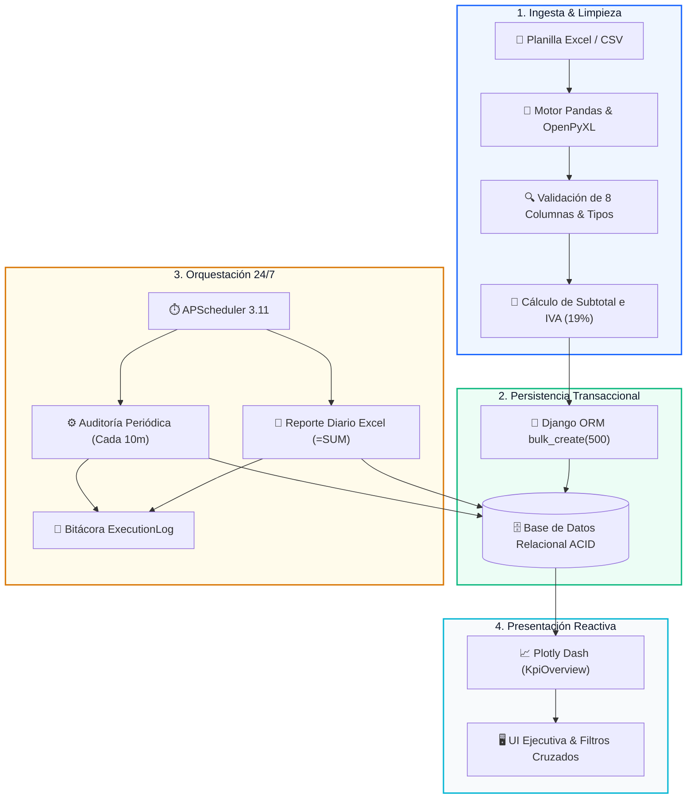

<div align="center">

# ⚡ Enterprise Core — Python Analytics & ETL Suite

**Plataforma Integral de Auditoría Comercial, Pipeline ETL y Analítica Reactiva 100% Python**

[](https://www.python.org/)
[](https://www.djangoproject.com/)
[](https://dash.plotly.com/)
[](https://pandas.pydata.org/)
[](https://apscheduler.readthedocs.io/)
[](https://docs.pytest.org/)
[](LICENSE)

<br/>

<p align="center">
  <a href="#-características-principales">Características</a> •
  <a href="#-arquitectura-del-sistema">Arquitectura</a> •
  <a href="#-recorrido-por-módulos">Módulos</a> •
  <a href="#-esquema-de-datos">Contrato de Datos</a> •
  <a href="#-puesta-en-marcha">Puesta en Marcha</a> •
  <a href="#-credenciales">Credenciales</a> •
  <a href="#-pruebas">Pruebas</a>
</p>

</div>

---

> **Enterprise Core** centraliza la ingesta masiva de planillas comerciales en Excel o CSV, normaliza y valida cada línea financiera mediante **Pandas**, persiste atómicamente los datos en base relacional **Django**, ejecuta tareas periódicas de auditoría mediante **APScheduler** y presenta tableros interactivos reactivos con **Plotly Dash**, **sin una sola línea de JavaScript externo**.

---

## 🌟 Características Principales

<table>
  <tr>
    <td width="50%">
      <h3 align="left">🔄 Pipeline ETL Vectorizado</h3>
      <ul>
        <li>Ingesta automática de libros <code>.xlsx</code> y <code>.csv</code>.</li>
        <li>Validación estricta de 8 columnas requeridas y coerción de tipos.</li>
        <li>Cálculo en memoria de subtotal, tasa de IVA (19%) e importes netos.</li>
        <li>Inserciones atómicas por lotes con <code>bulk_create(batch_size=500)</code>.</li>
      </ul>
    </td>
    <td width="50%">
      <h3 align="left">📊 Inteligencia de Negocios Reactiva</h3>
      <ul>
        <li>Tableros dinámicos en vivo con <strong>Plotly Dash</strong>.</li>
        <li>Filtros cruzados por región, categoría de producto y estado de pago.</li>
        <li>Gráficos de barras agrupadas, donut de cobranza y evolución temporal.</li>
        <li>Zero Node.js, zero React, renderizado 100% Python.</li>
      </ul>
    </td>
  </tr>
  <tr>
    <td width="50%">
      <h3 align="left">⏱️ Orquestador en Background 24/7</h3>
      <ul>
        <li>Motor <strong>APScheduler 3.11</strong> integrado en el ciclo de Django.</li>
        <li>Auditoría periódica automática cada 10 minutos.</li>
        <li>Generación nocturna de reportes consolidados en Excel con fórmulas nativas.</li>
        <li>Bitácora de auditoría inmutable con tiempos de respuesta en segundos.</li>
      </ul>
    </td>
    <td width="50%">
      <h3 align="left">🎨 Interfaz Ejecutiva de Alta Precisión</h3>
      <ul>
        <li>Diseño contemporáneo en lienzo claro con barra lateral Dark Navy.</li>
        <li>Tarjetas blancas nítidas con cifras tabulares y badges de estado.</li>
        <li>Cumplimiento estricto de accesibilidad <strong>WCAG AA</strong> (contraste &gt; 5.5:1).</li>
        <li>0 infracciones detectadas por el auditor de diseño Impeccable.</li>
      </ul>
    </td>
  </tr>
</table>

---

## 📐 Arquitectura del Sistema



---

## 🗂️ Recorrido por Módulos y Rutas

| Ruta | Módulo | Propósito y Funcionalidad |
|---|---|---|
| **`/`** | `core:landing` | **Portal Principal:** Acceso al sistema, credenciales de prueba, contrato del esquema contable y accesos directos a la suite. |
| **`/dashboard/`** | `core:dashboard` | **Consolidado Operativo:** 4 métricas clave en vivo, accesos rápidos a operaciones, últimos documentos procesados y bitácora reciente. |
| **`/auth/login/`** | `authentication:login` | **Autenticación Corporativa:** Formulario de inicio de sesión estilizado, caja de ayuda con credenciales y redirección automática. |
| **`/documents/`** | `documents:list` | **Gestión Documental & ETL:** Dropzone de carga de archivos, descarga de plantilla oficial (.xlsx), simulador de 120 facturas y repositorio. |
| **`/dashboards/analytics/`** | `dashboards:analytics` | **Analítica Plotly Dash:** Tablero reactivo interactivo con KPIs de ingresos, unidades, ticket promedio y gráficos cruzados. |
| **`/automations/`** | `automations:control_panel` | **Centro de Automatización:** Tareas activas de APScheduler, disparador manual bajo demanda y descarga de reportes consolidados. |
| **`/admin/`** | `admin:index` | **Panel Administrativo:** Control granular de tablas, registros comerciales y permisos de usuario. |

---

## 📋 Contrato de Datos (Esquema Obligatorio)

Cualquier archivo `.xlsx` o `.csv` cargado a través del pipeline debe cumplir con el siguiente contrato de **8 campos obligatorios**:

```text
┌────────────────────┬──────────────────┬────────────────────────────────────────────────────────┐
│ CAMPO              │ TIPO DE DATO     │ DESCRIPCIÓN Y REGLA DE AUDITORÍA                       │
├────────────────────┼──────────────────┼────────────────────────────────────────────────────────┤
│ codigo_factura     │ VARCHAR(50)      │ Identificador único alfanumérico de factura            │
│ cliente            │ VARCHAR(150)     │ Razón social o nombre verificado del comprador         │
│ region             │ VARCHAR(100)     │ Segmento geográfico (ej. Norte, Centro, Sur)           │
│ categoria_producto │ VARCHAR(100)     │ Clasificación comercial del producto o servicio        │
│ cantidad           │ INTEGER          │ Unidades transaccionadas (entero > 0)                  │
│ precio_unitario    │ DECIMAL(12,2)    │ Precio neto unitario (flotante/decimal > 0)            │
│ fecha_transaccion  │ DATE             │ Fecha de emisión contable en formato YYYY-MM-DD        │
│ estado             │ VARCHAR(20)      │ Estado de pago: PAID (Pagada) | PENDING | CANCELLED    │
└────────────────────┴──────────────────┴────────────────────────────────────────────────────────┘
```

> 💡 **Descarga de Plantilla Oficial:** Puede descargar directamente una planilla de prueba con 50 registros formateados en:  
> `http://127.0.0.1:8000/media/plantilla_prueba_auditoria.xlsx`

---

## 🚀 Puesta en Marcha Rápida

### 1. Clonar el Repositorio
```bash
git clone https://github.com/andres549/proyecto_python.git
cd proyecto_python
```

### 2. Activar Entorno Virtual
```powershell
# En Windows (PowerShell)
.\venv\Scripts\Activate.ps1
```

### 3. Aplicar Migraciones
```bash
python manage.py migrate
```

### 4. Iniciar el Servidor de Desarrollo
```bash
python manage.py runserver 127.0.0.1:8000
```

Abra su navegador en: **[`http://127.0.0.1:8000/`](http://127.0.0.1:8000/)**

---

## 🔑 Credenciales de Acceso

El sistema incluye un superusuario preconfigurado para pruebas de auditoría y evaluación inmediata:

| Campo | Valor |
|---|---|
| **Usuario** | `admin` |
| **Contraseña** | `adminpassword2026` |
| **Nivel de Acceso** | Superusuario con privilegios completos de administración |

---

## 🧪 Suite de Pruebas Automatizadas

El proyecto cuenta con **12 pruebas automatizadas** que garantizan la integridad del pipeline ETL, los servicios de cálculo contable y las respuestas HTTP:

```powershell
.\venv\Scripts\pytest
```

```text
============================= test session starts =============================
tests/integration/test_etl_and_automations.py::test_full_etl_lifecycle PASSED  [  8%]
tests/integration/test_etl_and_automations.py::test_automation_tasks PASSED   [ 16%]
tests/integration/test_views.py::test_landing_view PASSED                   [ 25%]
tests/integration/test_views.py::test_dashboard_view PASSED                 [ 33%]
tests/integration/test_views.py::test_documents_view PASSED                 [ 41%]
tests/integration/test_views.py::test_automations_view PASSED               [ 50%]
tests/integration/test_views.py::test_analytics_view PASSED                 [ 58%]
tests/unit/test_environment.py::test_django_settings_loaded PASSED          [ 66%]
tests/unit/test_cleaner.py::test_clean_commercial_dataframe_success PASSED    [ 75%]
tests/unit/test_cleaner.py::test_clean_commercial_dataframe_missing_cols PASSED [ 83%]
tests/unit/test_environment.py::test_base_directory_exists PASSED           [ 91%]
tests/unit/test_excel.py::test_generate_styled_excel_report PASSED          [100%]
======================== 12 passed, 1 warning in 0.95s ========================
```

---

## 📁 Estructura del Repositorio

```text
proyecto_python/
├── apps/
│   ├── authentication/     # Login corporativo y control de sesiones
│   ├── automations/        # Demonio APScheduler 3.11 y bitácoras
│   ├── core/               # Portal de acceso y dashboard operacional
│   ├── dashboards/         # Integración Dash + Plotly
│   │   └── dash_apps/      # Aplicación reactiva KpiOverview
│   └── documents/          # Ingesta, validación y pipeline ETL
├── config/                 # Configuración de Django (settings, urls, wsgi, asgi)
├── media/                  # Repositorio de plantillas, reportes y uploads
├── services/
│   ├── data_cleaner.py     # Sanitización y cálculo de impuestos con Pandas
│   ├── db_engine.py        # Singleton SQLAlchemy de conexión
│   └── excel_processor.py  # Generación de reportes estilizados OpenPyXL
├── templates/              # Vistas HTML5 con diseño ejecutivo coherente
├── tests/                  # Suite de pruebas unitarias y de integración
├── manage.py               # Orquestador CLI de Django
├── pytest.ini              # Configuración de pruebas Pytest
└── requirements.txt        # Dependencias fijadas del entorno
```

---

<div align="center">

**Enterprise Core** — *Desarrollado con rigor arquitectónico 100% Python*  
© 2026 Andrés Cassiani. Todos los derechos reservados.

</div>
